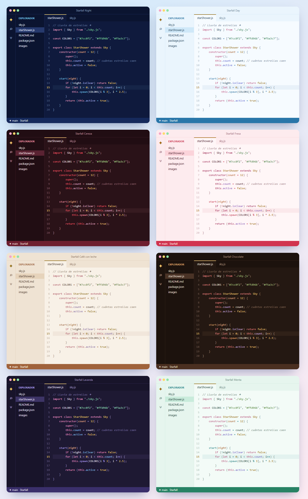

# Starfall Theme

Temas para VS Code con colores bonitos. Son 8, cada uno con su versión de noche o de día, y todos con estrellita amarilla en el cursor.

| Tema | Estilo | Colores |
|---|---|---|
| **Starfall Night** | oscuro | azul noche y azul cielo |
| **Starfall Day** | claro | azul cielo clarito |
| **Starfall Cereza** | oscuro | rojo vino y rosa |
| **Starfall Fresa** | claro | rosita con rojo |
| **Starfall Café con leche** | claro | café suave y crema |
| **Starfall Chocolate** | oscuro | café profundo con caramelo |
| **Starfall Lavanda** | oscuro | morado suave |
| **Starfall Menta** | claro | verde menta |

Todos se ajustan para que el código se lea bien: si un color queda muy pálido sobre el fondo, se oscurece hasta que se vea claro.

## Instalación
1. Descarga el `.vsix` de [Releases](https://github.com/ccrccne/starfall-vscode/releases).
2. En VS Code abre la pestaña de extensiones, pulsa `···` → **Instalar desde VSIX…** y elige el archivo.

Después: `Ctrl + K`, `Ctrl + T` y elige el tema que más te guste.

## Licencia
[MIT](LICENSE). Hecho por **ccrccne** · [ccrccne.github.io](https://ccrccne.github.io)
