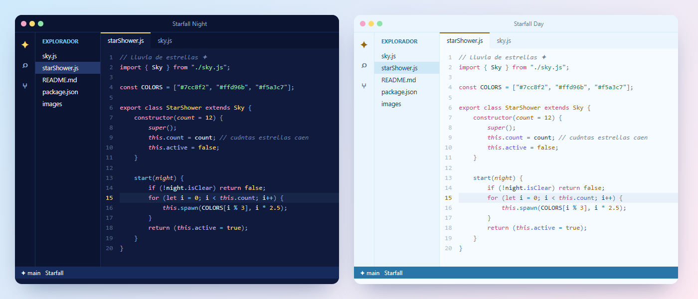

# Starfall Theme

Un tema para VS Code con los colores del cielo: azul, amarillo estrella y un toque rosita. Viene en dos versiones, una para programar de noche y otra de día.

- **Starfall Night**: azul noche profundo, para cuando quieres descansar la vista.
- **Starfall Day**: azul cielo clarito, para los días con mucha luz.

Los dos usan la misma paleta, así que puedes cambiar de uno a otro sin perderte en el código.

## Instalación
1. Descarga el `.vsix` de [Releases](https://github.com/ccrccne/starfall-vscode/releases).
2. En VS Code abre la pestaña de extensiones, pulsa `···` → **Instalar desde VSIX…** y elige el archivo.

Después: `Ctrl + K`, `Ctrl + T` y elige **Starfall Night** o **Starfall Day**.

## Colores
| | Noche | Día |
|---|---|---|
| Fondo | `#0f1a3d` | `#f6fbff` |
| Funciones | `#7cc8f2` | `#2f86c0` |
| Palabras clave | `#f5a3c7` | `#c2477a` |
| Textos | `#8ee3a8` | `#2e8a52` |
| Números y clases | `#ffd96b` | `#c98a0a` |

## Licencia
[MIT](LICENSE). Hecho por **ccrccne** · [ccrccne.github.io](https://ccrccne.github.io)
